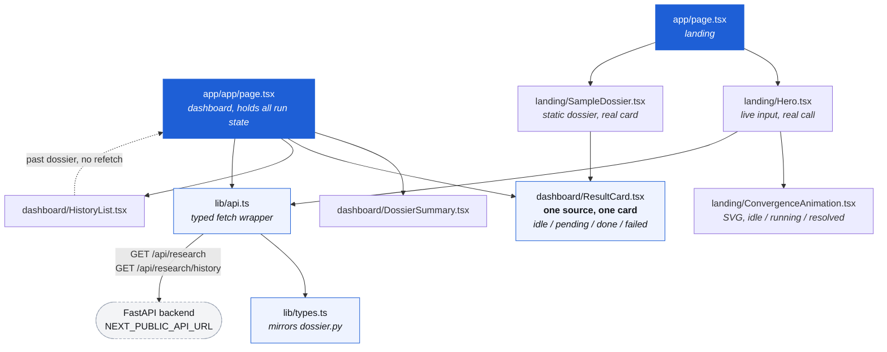

# Inroad — Web

The frontend for [`inroad-api`](../inroad-api). One domain in, one
dossier out: homepage, recent news, and hiring signal, checked at the same
time and rendered as three cards.

Next.js 14 App Router, TypeScript, Tailwind. No state library, no data-fetching
library, no UI kit, no chart library. `fetch` and React state are the whole
data layer.

## Why this exists

The backend already ships a working single-page UI at `GET /`. This is not a
replacement for it — it exists because the API and the interface are separate
concerns, and this proves it: the same `CompanyDossier` renders in a
separately-hosted app over CORS, with no backend change of any kind.

It is also where the two fields the bundled UI never surfaced finally show up.
`from_cache` becomes a badge, and `/api/research/history` becomes a list you
can click.

## Architecture



`ResultCard` is the load-bearing piece. The landing page's sample dossier and
the dashboard's live results are the same component with different props, so
the preview on the marketing page cannot drift away from the real thing — if
the card changes, both change.

### Design tokens

Eight colours, declared once as CSS custom properties in
[globals.css](app/globals.css) and wired into Tailwind in
[tailwind.config.ts](tailwind.config.ts). No component contains a hex value.

| Token | Value | Used for |
| --- | --- | --- |
| `ink` | `#0E121B` | Page background |
| `surface` | `#171D2B` | Cards, inputs |
| `surface-raised` | `#1F273A` | Quiet buttons, loading blocks |
| `paper` | `#EDEAE2` | Text |
| `signal-amber` | `#E8A33D` | Resolved, done, primary action |
| `signal-teal` | `#46B8AC` | In progress, live, focus rings |
| `muted-rose` | `#C9645A` | Nothing found |
| `line` | `#2A3244` | Borders, dividers |

Two faces, both loaded with `next/font/google` in
[layout.tsx](app/layout.tsx) and self-hosted at build time — no CDN link tag.
Fragment Mono carries headlines, domains and every number; Public Sans carries
prose and buttons. The utility style (uppercase, 0.08em tracking, small) is a
single `.utility-label` class rather than a set of utilities repeated on every
eyebrow.

Amber means settled, teal means in flight or live. That is consistent
everywhere: a pulsing teal dot is a check still running, a solid amber dot is
one that finished, and the convergence animation ends by turning amber for the
same reason.

## What it does

**Landing page** — a working domain input in the hero that runs the real
backend and shows the real result inline, three source descriptions, a sample
dossier rendered with the production card, and a two-bar speed comparison using
the numbers measured in the backend's README (2.84s one at a time, 0.77s
together).

**Dashboard** — the same input, three cards that go from "still checking" to
their result, total time in large numerals, a cache badge, and a clickable list
of earlier runs.

Details that are easy to get wrong:

- **A partial dossier is a success, not an error.** The backend returns `200`
  with nulls in it. `lib/api.ts` only rejects on transport failure and `4xx`/
  `5xx`; a source that came back empty is a card in the "failed" state next to
  two that worked, not an error screen.
- **A failed card holds its size.** `ResultCard` has a `min-h-[16rem]` floor
  precisely so one empty source cannot shrink and drag the row around it.
- **`open_roles: null` and `open_roles: 0` read differently.** Null renders as
  "Hiring, roles not counted", zero as "no open roles right now", because
  upstream those mean different things.
- **Optional fields are `X | null`, not `X?`.** Pydantic serialises the key and
  sets it to null; it does not omit it. Typing it as optional would make a
  missing key look normal when it would actually be a bug.
- **Reduced motion is handled by landing on the finished state.** The global
  rule in `globals.css` collapses every animation to a single 0.01ms pass,
  which leaves each SVG path fully drawn — that is exactly the static converged
  picture, so nothing has to be re-specified for it.

### Three places the design brief and the API disagree

Called out rather than papered over, because in each case the interface does
the honest thing instead of the specified thing:

- **`total_time_seconds` does not exist.** `CompanyDossier` has `elapsed_ms`,
  an integer. `lib/types.ts` mirrors the model as-is and `totalTimeSeconds()`
  divides for display. The large numeral on the dashboard is that value.
- **Nothing in a dossier has a timestamp**, so "12m ago" cannot come from the
  response. `lib/api.ts` records in `localStorage` when *this browser* last saw
  a domain fetched live, and that is the only source of the relative time. A
  history row from another browser or another session says "earlier" instead of
  inventing a number.
- **The three cards fill in together, not one by one.** They genuinely run
  concurrently on the server, but the endpoint replies once, when the last of
  them is done — so there is a single moment at which all three land. Staggering
  them in the UI would mean faking timings the API never sent. The dashboard
  says so in one line under the cards instead. Real per-source arrival needs
  streaming, which is already listed as a next step in the backend's README.

### Routes

| Route | What it is |
| --- | --- |
| `/` | Landing page, with a live input in the hero |
| `/app` | Dashboard: search, three cards, summary, history |

### Backend endpoints used

| Call | Used by |
| --- | --- |
| `GET /api/research?domain=` | Hero input, dashboard search |
| `GET /api/research/history` | `HistoryList`, refreshed after each run |

Both are `GET`, which matches the backend's CORS config — it allows
`allow_methods=["GET"]` only.

## Running locally

Requires **Node 18.17 or newer**, **pnpm 11** (see `packageManager` in
`package.json`), and a running backend.

Start the backend first:

```bash
cd ../inroad-api
source .venv/bin/activate
uvicorn app.main:app --reload --port 8000
```

Then this app:

```bash
cd inroad-web
pnpm install
cp .env.example .env.local     # optional, defaults to http://127.0.0.1:8000
pnpm dev
```

Open <http://localhost:3000>.

```bash
pnpm build       # production build, also type-checks
pnpm typecheck   # types only
pnpm lint
```

### CORS

The backend allows exactly one origin, `ALLOWED_ORIGIN`, default
`http://localhost:3000` — which is Next's dev default, so the pair works with
no configuration. Run this app on another port and the backend needs to be told:

```bash
ALLOWED_ORIGIN=http://localhost:3001 uvicorn app.main:app --port 8000
```

**Open the app at `http://localhost:3000`, not `http://127.0.0.1:3000`.**
Browsers treat those as different origins and the backend allows only the
first, so the 127.0.0.1 spelling gets every call blocked while the page itself
loads fine. Verified against a running pair:

```
Origin: http://localhost:3000   ->  access-control-allow-origin: http://localhost:3000
Origin: http://127.0.0.1:3000   ->  (no header, browser blocks the response)
```

If you prefer the numeric form, start the backend with
`ALLOWED_ORIGIN=http://127.0.0.1:3000`.

A blocked origin and a backend that is not running look identical from the
browser, so `lib/api.ts` names both possibilities in that one error message
rather than guessing.

## What this project does not do (on purpose)

- **No server-side data fetching.** Every call is from the browser. The pages
  are static; the backend's history and cache are per-process and reset on
  restart, so prerendering them on the server would only produce a snapshot
  that is wrong by the time it is seen.
- **No state library and no data-fetching library.** Two screens and one
  endpoint do not need one. Run state is `useState` in the dashboard page,
  which is also the only component that owns any.
- **No client-side cache.** The backend already has a TTL cache and reports
  `from_cache`. A second cache here would make that badge lie.
- **No chart library.** The speed comparison is two divs with a width
  percentage.
- **No auth, no accounts, no persistence.** The only thing written to the
  browser is the `localStorage` map of when a domain was last fetched live, and
  losing it costs a relative timestamp and nothing else.
- **No streaming.** See the third point above — this is the one that would
  change the interface most, and it is a backend change first.

Also skipped: no dark/light toggle (the palette is one dark theme, deliberately),
no retry-on-failure button (re-running the search is the retry), and no
pagination on history — the backend caps it at `HISTORY_LIMIT`, default 20.

## Deployment

Not deployed anywhere yet, and unlike the backend there is no container here —
this is a standard Next.js app and the intended target is Vercel.

```bash
pnpm build
pnpm start          # serves the production build on :3000
```

Both commands are verified locally; the hosted deploy below is not.

For **Vercel**: import the repo, set the root directory to
`inroad-web`, and set `NEXT_PUBLIC_API_URL` to the deployed backend's
URL. Then set `ALLOWED_ORIGIN` on the backend to the Vercel URL, or the browser
will block every call.

Note that `NEXT_PUBLIC_` variables are inlined at build time, not read at run
time — changing the API URL means rebuilding, not just restarting.

Both pages are static, so any host that can serve a Next.js build works. There
is no server-side rendering of data and no API route in this app; it is a
client for someone else's API.

## Possible next steps

- Consume a streaming endpoint so each card lands as its own source finishes,
  which is the one thing the current interface has to explain in words instead
  of showing
- Let a history row be linked directly, e.g. `/app?domain=stripe.com`
- Show `errors` from a partial dossier in the history list, so a row makes it
  obvious it was incomplete before you open it
- A small test pass: `ResultCard` in all four states and `lib/api.ts` against a
  mocked `fetch`

## Project layout

```
inroad-web/
├── app/
│   ├── layout.tsx                   # fonts via next/font, root html shell
│   ├── globals.css                  # design tokens as CSS custom properties
│   ├── page.tsx                     # landing page, route: /
│   └── app/
│       └── page.tsx                 # dashboard, route: /app, owns all run state
├── components/
│   ├── landing/
│   │   ├── Nav.tsx
│   │   ├── Hero.tsx                 # live domain input, runs the real tool
│   │   ├── ConvergenceAnimation.tsx # SVG, three lines in, amber outline out
│   │   ├── SourcesSection.tsx       # SOURCE_01 / 02 / 03
│   │   ├── SampleDossier.tsx        # static dossier, rendered with ResultCard
│   │   ├── SpeedComparison.tsx      # two divs, real measured numbers
│   │   └── Footer.tsx
│   ├── dashboard/
│   │   ├── SearchBar.tsx
│   │   ├── ResultCard.tsx           # one source; idle/pending/done/failed
│   │   ├── DossierSummary.tsx       # elapsed time + cache badge
│   │   └── HistoryList.tsx
│   └── ui/
│       ├── Button.tsx
│       ├── Badge.tsx
│       ├── Input.tsx
│       └── StatusDot.tsx
├── lib/
│   ├── api.ts                       # typed fetch wrapper + display helpers
│   └── types.ts                     # mirrors app/models/dossier.py
├── tailwind.config.ts               # every colour token, no hex in components
├── next.config.js
├── postcss.config.js
├── tsconfig.json
├── .env.example
└── README.md
```
