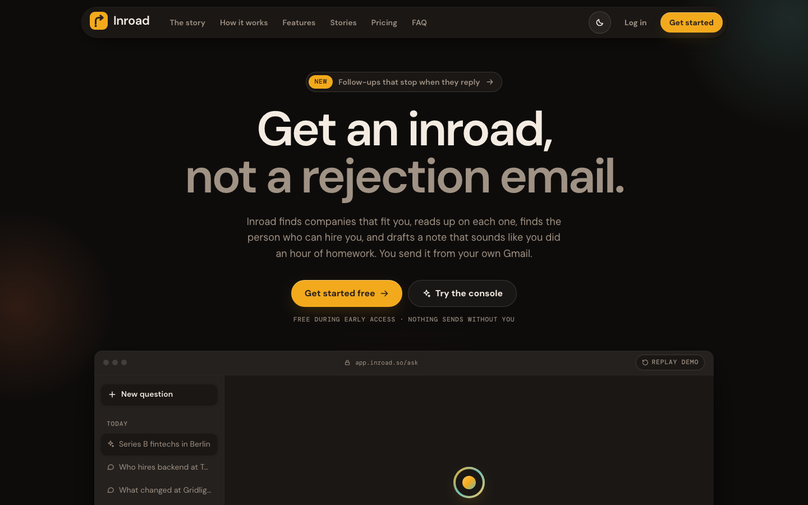

<p align="center">
  <picture>
    <source media="(prefers-color-scheme: dark)" srcset=".github/assets/inroad-logo-dark.png">
    
  </picture>
</p>

<h3 align="center">inroad-web</h3>

<p align="center">
  The Inroad web app, built with Next.js.
</p>

<p align="center">
  <a href="https://github.com/Inroad-Ai/inroad-docs">Docs</a> ·
  <a href="https://github.com/Inroad-Ai/inroad-web/issues">Issues</a> ·
  <a href="CONTRIBUTING.md">Contributing</a> ·
  <a href="https://www.devweekends.com/dwosi">DWOSI</a>
</p>

<p align="center">
  <a href="LICENSE"></a>
  <a href="https://github.com/Inroad-Ai/inroad-web/actions/workflows/ci.yml"></a>
  <a href="https://www.devweekends.com/dwosi"></a>
</p>

<p align="center">
  
</p>

The web frontend for Inroad. A Next.js App Router app in TypeScript and Tailwind that renders every
screen and talks to one backend, `inroad-api`.

Inroad is for people job hunting who have given up on job boards. You build a profile once, and the
platform finds companies that fit, researches each one, and drafts outreach that reads like a person
did the homework.

## How it fits

```
inroad-web (Next.js) ──> inroad-api (FastAPI + arq worker) ──> inroad-sourcing (public company data)
                                     └──> inroad-intelligence (opportunity feed) ──> inroad-sourcing
```

- This app talks only to [`inroad-api`](https://github.com/Inroad-Ai/inroad-api), through the typed
  client in `lib/api-client/`. There is no API route in this repo.
- It never calls [`inroad-sourcing`](https://github.com/Inroad-Ai/inroad-sourcing),
  [`inroad-intelligence`](https://github.com/Inroad-Ai/inroad-intelligence) or any third-party
  provider directly. The API decides what to ask them.
- Architecture and local full-stack setup live in
  [`inroad-docs`](https://github.com/Inroad-Ai/inroad-docs). See
  [system-architecture.md](https://github.com/Inroad-Ai/inroad-docs/blob/main/docs/architecture/system-architecture.md)
  (section 5 covers this app).

## What it does

Routes live in `app/`, split into route groups:

- `(marketing)`: landing page (`/`), `/privacy`, `/terms`.
- `(auth)`: `/signup`, `/login`, `/verify-email`, `/forgot-password`, `/reset-password`, and
  `/auth/callback` for Google sign-in.
- `(onboarding)`: `/onboarding` builds the profile step by step (resume upload, target role, work
  preferences, links); `/onboarding/connect` offers the optional connections.
- `(dashboard)`, signed-in only:
  - `/overview`: where the search stands.
  - `/research`: research a company from its website, with per-source progress streamed from the
    API, or run a match scan that finds companies from your profile.
  - `/companies`, `/companies/[id]`, `/companies/pipeline`: saved companies, the company report
    (hiring, products, leadership, sourced facts with evidence, people, news), and a stage board.
  - `/contacts`, `/contacts/[id]`: people found at researched companies, by outreach stage.
  - `/notifications`: hiring posts that fit your target roles and news from saved companies.
  - `/profile`: the profile everything runs on, including resume management.
  - `/integrations`: Gmail, Apollo.io, Hunter.io, and your own AI model key for outreach drafts.
  - `/settings`: account, password, and alert settings.

`middleware.ts` and `app/(dashboard)/layout.tsx` verify the access token against `JWT_SECRET` and
refresh it through the API when it has expired.

## Tech stack

From `package.json`:

- Next.js `^15.5.28` (App Router), React `19.3.1`, TypeScript `5.5.3`
- Tailwind CSS `3.4.6`, PostCSS, Autoprefixer
- `openapi-fetch` `^0.17.0` with types generated by `openapi-typescript` `^7.13.0`
- `zod` `^4.6.7`, `jose` `^6.2.12` (JWT verification), `framer-motion` `^13.4.1`, `recharts`
  `^2.15.4`, `libphonenumber-js`, `country-region-data`
- ESLint 8 with `eslint-config-next`, Prettier 3, Husky 9, lint-staged
- pnpm `11.9.0` (the `packageManager` field)

## Getting started

### Prerequisites

- Node.js. CI builds with Node 22; use that.
- pnpm 11 (`packageManager` pins `pnpm@11.9.0`; Corepack will pick it up).
- A running `inroad-api`, which needs Postgres and Redis. Research also needs the API's arq worker
  and `inroad-sourcing`. Clone `inroad-api` and `inroad-docs` as siblings of this repo and follow
  the Quickstart in the `inroad-docs` README. `inroad-docs/local/inroad-local.sh up` starts the
  full stack, this app included.

Without the backend, only the marketing, legal and auth pages render. Everything else needs
`inroad-api`.

### Setup

```bash
git clone https://github.com/Inroad-Ai/inroad-web.git
cd inroad-web
git checkout staging
pnpm install
cp .env.example .env.local
```

`pnpm install` runs the `prepare` script, which installs the Husky git hooks. See
[CONTRIBUTING.md](CONTRIBUTING.md) for what each hook does.

### Configuration

`.env.example` lists the two variables:

- `NEXT_PUBLIC_API_URL`: where `inroad-api` listens, no trailing slash. Defaults to
  `http://127.0.0.1:8000`. It is inlined at build time, so changing it means a rebuild.
- `JWT_SECRET`: must equal `inroad-api`'s `JWT_SECRET`. Server-side only (middleware and layouts),
  never sent to the browser.

The API accepts one browser origin, its `ALLOWED_ORIGIN`, which defaults to
`http://localhost:3000`. Open the app at `http://localhost:3000`, not `http://127.0.0.1:3000`, or
the browser blocks every API call. To run on another origin, set `ALLOWED_ORIGIN` on the API to
match.

### Run

```bash
pnpm dev     # dev server on http://localhost:3000
pnpm build   # production build
pnpm start   # serve the production build
```

### Checks

CI runs these on every pull request. Run them before you push:

```bash
pnpm format:check
pnpm typecheck
pnpm lint
pnpm build
```

`pnpm format` rewrites files with Prettier. CI also runs a malware scan
(`scripts/detect-malware.py`) and a secret scan.

### Regenerating the API client

When `inroad-api`'s `/openapi.json` changes, regenerate the types with the API running and commit
the result:

```bash
pnpm generate-api-client
```

It reads `${NEXT_PUBLIC_API_URL:-http://127.0.0.1:8000}/openapi.json` and writes
`lib/api-client/schema.d.ts`. Do not hand-write `fetch()` calls to the backend.

## Project structure

```
inroad-web/
├── app/                # routes: (marketing), (auth), (onboarding), (dashboard)
├── components/
│   ├── ui/             # design-system primitives (Button, Input, Card, ...)
│   └── composed/       # feature components built from ui/ primitives
├── hooks/              # shared React hooks
├── lib/
│   ├── api-client/     # typed client for inroad-api (client.ts, generated schema.d.ts)
│   ├── auth-native/    # token cookies and JWT verification
│   ├── types/          # shared domain types
│   └── theme/          # light and dark theme handling
├── styles/tokens.css   # every design token
├── public/logos/       # logos for the services shown on Integrations
├── scripts/            # malware scan scripts used by hooks and CI
├── middleware.ts       # gates signed-in routes, refreshes expired tokens
├── tailwind.config.ts  # maps tokens to Tailwind classes
├── next.config.js
└── vercel.json         # Vercel install and build commands
```

## Design system

`styles/tokens.css` is the single source of truth for color, type and spacing, and
`tailwind.config.ts` exposes the tokens as classes. Only `components/ui/` may use raw tokens.
`components/composed/` builds from `ui/` primitives and never hardcodes a color, spacing value or
font size. Need a new value? Add a token first.

## Known gaps

- No automated tests. CI checks formatting, types, lint and the build, nothing more.
- No mock mode. You cannot work on the signed-in screens without a running `inroad-api`.
- The Node version is not pinned: `package.json` has no `engines` field and there is no `.nvmrc`.

## Contributing

All work goes through `staging`: branch from it and open pull requests into it. `main` only takes
merges from `staging`. [CONTRIBUTING.md](CONTRIBUTING.md) covers the branch flow, naming, hooks and
review. Issues labeled `good first issue` are a good place to start.

## Security

Report vulnerabilities privately. See [SECURITY.md](SECURITY.md).

## License

MIT. See [LICENSE](LICENSE).

Third-party logos in `public/logos/` are trademarks of their respective owners and are used only to
show which services Inroad connects to.

---

<p align="center">
  <a href="https://www.devweekends.com/dwosi">
    <picture>
      <source media="(prefers-color-scheme: dark)" srcset="https://www.devweekends.com/brand/dw-wordmark-white.png">
      
    </picture>
  </a>
</p>

<p align="center">
  <strong>Inroad is part of <a href="https://www.devweekends.com/dwosi">DWOSI</a>, the Dev Weekends Open Source Initiative.</strong><br>
  DWOSI is an initiative of <a href="https://devweekends.com/">Dev Weekends</a>. Free and open to every contributor.
</p>

<p align="center">
  <a href="https://devweekends.com/">Website</a> ·
  <a href="https://www.devweekends.com/dwosi">DWOSI</a> ·
  <a href="https://www.linkedin.com/company/devweekends/">LinkedIn</a> ·
  <a href="https://www.instagram.com/devweekends">Instagram</a> ·
  <a href="https://www.youtube.com/@devweekends">YouTube</a> ·
  <a href="https://discord.gg/Cy7Rgkf4Up">Discord</a>
</p>

<p align="center">
  Maintained by <strong>Abdul Moiz</strong> ·
  <a href="https://github.com/Abdul-Moiz31">GitHub</a> ·
  <a href="https://www.linkedin.com/in/im-abdulmoiz/">LinkedIn</a> ·
  <a href="https://medium.com/@iam-abdulmoiz">Medium</a> ·
  <a href="https://iamabdul-moiz.vercel.app/">Portfolio</a><br>
  <a href="mailto:abdul.moiz@devweekends.com">abdul.moiz@devweekends.com</a> ·
  <a href="mailto:abdulmoiz3140@gmail.com">abdulmoiz3140@gmail.com</a>
</p>
